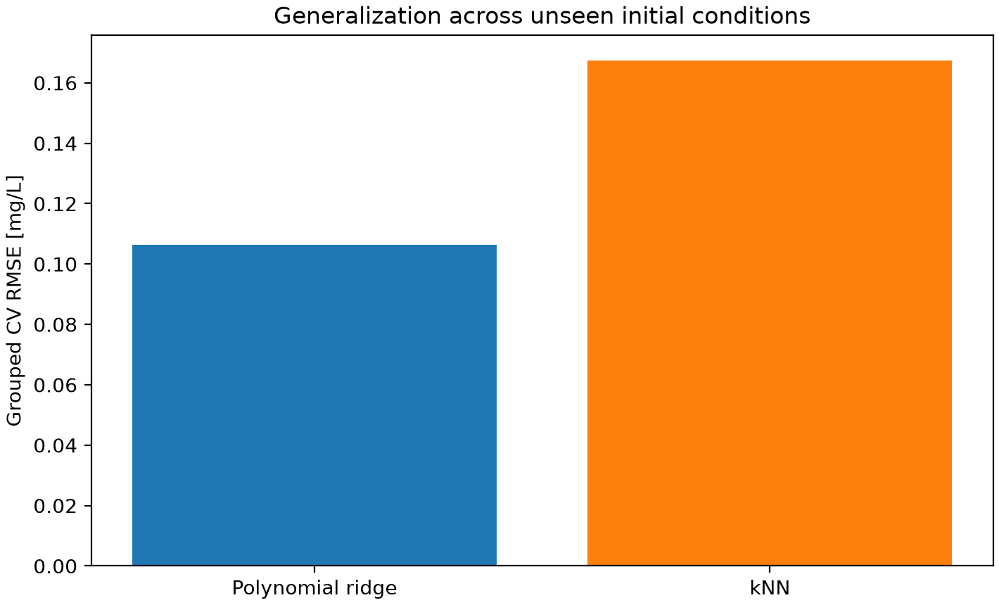
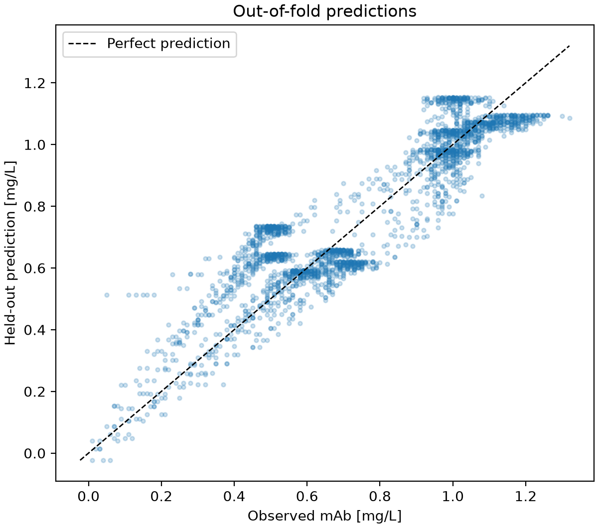
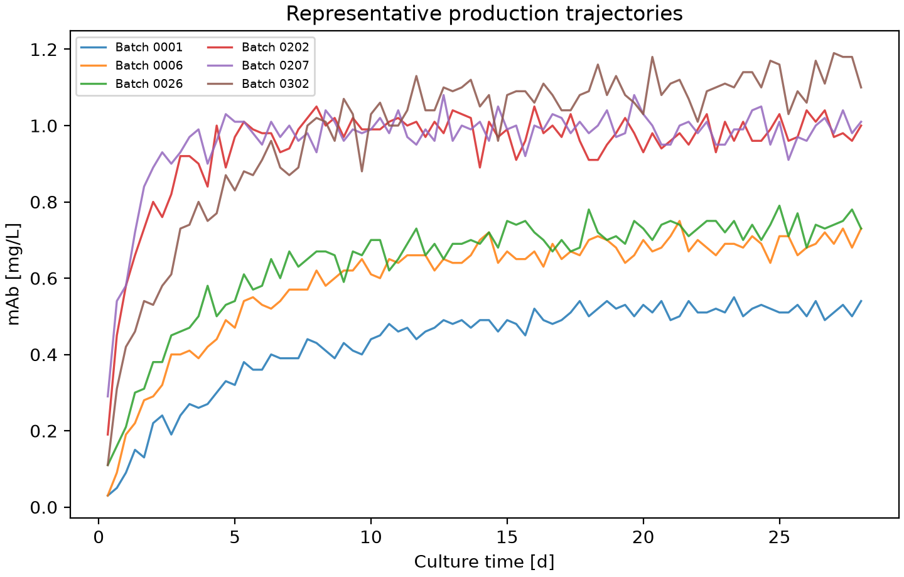
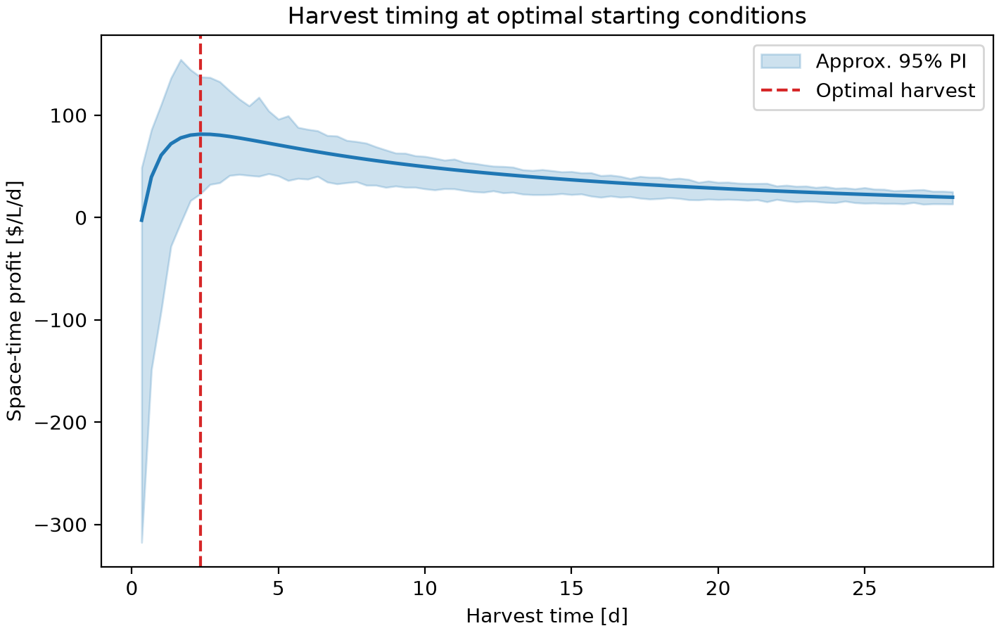
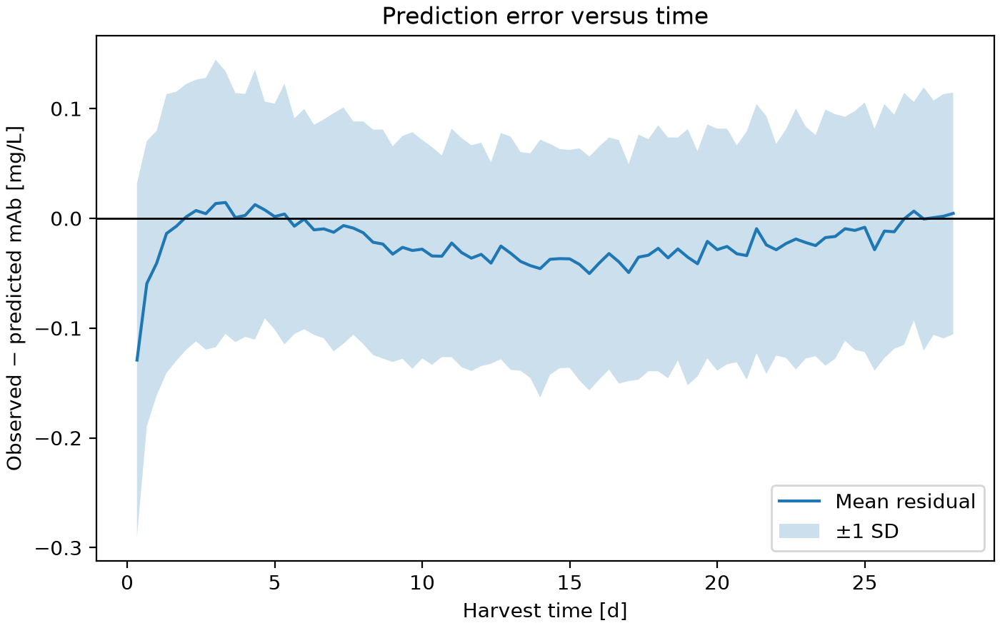

# Monoclonal Antibody Space-Time Profit Optimization

This project uses machine learning to identify profitable starting conditions and harvest times for monoclonal antibody (mAb) production. Thirty batch trajectories are used to compare regression models, predict antibody concentration, and calculate space-time profit with a one-day turnaround between batches. The program recommends initial nutrient concentrations, viable cell density, and harvest time, while exporting tables and figures that explain the results and their uncertainty.

---

## Highlights

- **Analyzed** 30 simulated mAb production batches and their initial operating conditions.
- **Developed** regression pipelines with grouped cross-validation and hyperparameter tuning.
- **Compared** polynomial ridge and k-nearest-neighbor models using unseen starting conditions.
- **Optimized** culture conditions and harvest time using production economics.
- **Visualized** model accuracy, batch trends, and harvest-time economics with reproducible figures.

---

## Environment

Versions used to develop and test the project:

- Python 3.13.5
- Matplotlib 3.10.8
- NumPy 2.3.5
- pandas 2.2.3
- scikit-learn 1.8.0

---

## Running the Project

Put `initial_conditions.csv` and the 30 batch files (`batch_0001.csv`–`batch_0006.csv`, `batch_0022.csv`–`batch_0027.csv`, `batch_0106.csv`–`batch_0108.csv`, `batch_0202.csv`–`batch_0210.csv`, and `batch_0301.csv`–`batch_0306.csv`) in `datasets/`. From the project directory, run:

```bash
python main.py
```

This single command reads the local CSV files, fits and compares models, finds the predicted optimum, and saves outputs to `figures/` and `tables/`. No downloads or additional scripts are required. The program accepts `batches_` as an alternative filename prefix. **Keep `initial_conditions.csv` in the repository:** it is required to match each batch ID with its starting glucose, glutamine, and VCD. The project will not run without it.

---

## Code Design

### Loading and checking the batch data

`main.py` creates a `MonoclonalAntibodyOptimizer` object and starts by loading the 30 selected batch files and `initial_conditions.csv` from `datasets/`. Each batch ID identifies one culture time series and links it to initial glucose, glutamine, and viable cell density (VCD). The program verifies the required columns, checks the batch identifiers, and rejects missing or invalid measurements. This protects the model from silently using mismatched initial conditions or incomplete files. Only the local files are used, keeping the workflow reproducible and within the 30-run experimental budget.

### Preparing features and harvest times

Every measurement becomes a training observation. The predictors are initial glucose [mM], initial glutamine [mM], initial VCD, and elapsed culture time; the target is measured mAb concentration [mg/L]. The initial nutrient values are taken from `initial_conditions.csv`, rather than the changing nutrient concentrations later in the batch. This is necessary because the objective is to recommend settings chosen **before** cultivation. Time is converted from hours to days, and VCD is scaled into millions of cells per millilitre for numerical stability. The model uses both elapsed time and `log(1 + time in days)` to better represent the early increase in mAb followed by slower growth. This simple transformation avoids forcing the response to be linear in time. Candidate harvest times are restricted to positive time points common to all batches, preventing extrapolation outside their observed time ranges.

### Training and validating regression models

The program compares polynomial ridge regression with k-nearest-neighbor (kNN) regression. Both use `StandardScaler` in a scikit-learn pipeline. Polynomial features allow interactions and curved responses, while ridge regularization limits coefficient instability. kNN instead estimates concentrations from nearby observations, providing a useful alternative when a single smooth polynomial is unsuitable. `GridSearchCV` tests polynomial degrees and penalties, or kNN neighborhood sizes and weighting methods. It selects the configuration with the lowest grouped cross-validation root-mean-squared error (RMSE).

The folds are grouped by the full initial-condition combination, not by individual time-series rows. Therefore, replicates and measurements from the same starting conditions stay together in training or validation. Without this separation, a model could appear accurate simply because it has already seen other time points from nearly identical cultures. The program also records held-out predictions and residuals, which are used to assess prediction quality and uncertainty rather than relying on training error alone.

### Calculating profit and finding the optimum

After model selection, the winning regressor is fitted to all 30 batches. It predicts mAb concentration for each **observed** starting-condition combination at each allowed harvest time. Culture value is calculated as 1,000 times predicted mAb concentration. Culture cost accounts for starting glucose, glutamine, and VCD. Space-time profit is then calculated by subtracting culture cost from value and dividing by harvest time plus the required one-day downtime. Space-time yield uses mAb concentration divided by the same total cycle time, making it possible to distinguish productivity from profitability.

The program selects the candidate with the highest predicted space-time profit. It does not search arbitrary unmeasured initial-condition combinations, because glucose and glutamine are correlated in these 30 runs. To describe uncertainty, it estimates time-specific 95% prediction limits from held-out prediction errors and propagates them to value, profit, and yield. These limits are approximate and do not prove that the selected setting is globally optimal.

### Exporting figures and tables

Finally, `main.py` calls the export stage. Code in `src/` uses `os.path.join()` to write CSV tables into `tables/` and PNG figures into `figures/`. The tables retain exact numerical results for inspection, while the figures make model performance and economic trade-offs easier to interpret. The README documents the results from the supplied 30 batches and is not modified by the Python program. All five figures are embedded below using relative paths, so they display directly on GitHub. If the input data or model settings change, the report can be reviewed and updated using the new exported tables.

---

## Analysis

### Experimental selection and coverage

The 30 batches were selected as **ten distinct starting-condition combinations, each repeated three times**. The included files are `0001`–`0006`, `0022`–`0027`, `0106`–`0108`, `0202`–`0210`, and `0301`–`0306`. They cover three starting glucose levels (5, 10, and 15 mM), four glutamine levels (1, 2, 3, and 6 mM), and several starting viable cell densities. Choosing complete triplicate groups, rather than 30 unrelated runs, makes it easier to distinguish replicate variability from differences caused by starting conditions and supports fairer validation. This also provides better controlled nutrient comparisons than the previous selection, which tied most glucose levels to one glutamine level.

The selection was made to permit several **controlled comparisons**. At 5 mM glucose and 200,000 cells/mL, batches with 1, 2, and 6 mM glutamine can be compared while the other starting factors remain fixed. At 5 mM glucose and either 1 or 2 mM glutamine, initial VCD can be compared at 200,000 and 400,000 cells/mL. The 10 mM glucose, 3 mM glutamine group gives three VCD levels (1.0, 1.2, and 1.4 million cells/mL), and the 15 mM glucose, 1 mM glutamine group gives two (600,000 and 800,000 cells/mL). These contrasts are useful for analyzing the role of individual variables without adding specialized sensitivity-analysis methods.

**This is not a complete factorial experiment.** Glucose concentration remains linked to different VCD ranges at 10 and 15 mM, and not every glucose–glutamine combination was measured. Thus, the model can compare the tested starting conditions but cannot independently isolate every factor across the full possible design space. The optimization deliberately searches only the ten measured combinations and observed harvest times.

**[Table 1 — Selected batches](tables/selected_batches.csv)** lists all 30 IDs and their initial glucose, glutamine, and VCD values. It documents the ten triplicate condition groups and shows which nutrient and VCD comparisons can be made before interpreting model predictions. In particular, the table distinguishes repeated runs from genuinely different starting conditions. Replicates increase the amount of measured time-series data but do not provide as many independent conditions for testing how well a model generalizes. This distinction motivates grouping the folds by starting conditions.

### Model comparison and accuracy

Two regression approaches were tested. Polynomial ridge offers smooth interpolation and interpretable interactions, but its assumed functional form may miss irregular responses. kNN adapts to local patterns without specifying a polynomial, although it is sensitive to input scaling and performs poorly when asked to extrapolate. Polynomial degree, ridge penalty, kNN neighbor count, and neighbor weighting were tuned by grouped cross-validation rather than chosen from training performance.

**Figure 1** compares validation RMSE for both models. Lower RMSE indicates more accurate predictions on held-out starting-condition groups. Polynomial ridge performs better on this selection (0.106 mg/L versus 0.167 mg/L for kNN), so it is selected for economic optimization. Its best polynomial degree is 1; the extra logarithmic time feature still lets it capture a curved production profile. **[Table 2 — Model comparison](tables/model_comparison.csv)** records training and validation RMSE, their variability, and the selected hyperparameters; it supports the choice of architecture rather than relying on a single figure.



**Figure 2** compares held-out predictions against measured mAb concentrations. Points close to the dashed diagonal indicate accurate predictions; departures from the line reveal errors that a single RMSE cannot show. The overall pattern follows the diagonal, although individual estimates deviate. Looking at the complete spread of points is useful because a good average error does not guarantee that every batch is predicted equally well. **[Table 3 — Held-out predictions](tables/held_out_predictions.csv)** contains each observed concentration, prediction, residual, batch ID, and time, allowing errors to be examined in detail.



### Production profiles and harvest timing

**Figure 3** shows representative batch mAb trajectories. Concentrations often rise rapidly before approaching a plateau, but the plateau and fluctuations differ among starting conditions. The plotted subset allows individual curves to be distinguished without overlapping all 30 series in one graph. This is why selecting harvest time solely from the final mAb concentration is not appropriate: a longer run may make more product while tying up the reactor for additional days. The trajectories also show why culture time is included as a model input rather than predicting only a final endpoint.



Space-time profit divides the value remaining after culture cost by harvest duration **plus one day of downtime**. **Figure 4** plots predicted profit against harvest time at the recommended initial conditions. The dashed vertical line marks the selected harvest time; the shaded region is an approximate 95% prediction interval. The predicted profit curve peaks at 56 hours, before the end of the observed trajectories, showing why continuing production is not always economically beneficial. This avoids the misleading first-time-point optimum produced by a preliminary model that assumed an entirely linear time response. **[Table 4 — Prediction-interval residuals](tables/prediction_interval_residuals.csv)** provides the held-out error quantiles used to calculate the uncertainty band at each recorded time.



### Economic recommendation

The decision is based on predicted **space-time profit**, not maximum final mAb concentration or maximum space-time yield. Initial culture cost is calculated as $10 per mM of glucose, $20 per mM of glutamine, and $0.0005 per cell/mL of initial VCD, all per litre. mAb value is $1,000 per mg/L. Adding nutrients or cells is worthwhile only when the additional antibody value offsets their cost and any change in total batch duration.

### Validated model performance and recommendation

The selected architecture was **polynomial ridge** with `polynomialfeatures__degree=1` and `ridge__alpha=0.1` applied to the initial conditions, elapsed time, and the logarithmic time feature. Its mean grouped cross-validation RMSE was **0.106 mg/L** (standard deviation **0.033 mg/L**). The alternative **kNN** obtained **0.167 mg/L** with 15 neighbors and distance weighting. For ridge, pooled held-out RMSE was **0.111 mg/L** and out-of-fold R² was **0.841**. These diagnostics use groups of starting conditions held out during prediction; the selected model is then fitted on all 30 batches for optimization.

| Metric | Estimate | Approx. 95% PI lower | Approx. 95% PI upper |
| --- | ---: | ---: | ---: |
| Initial glucose [mM] | 15.00 | — | — |
| Initial glutamine [mM] | 1.00 | — | — |
| Initial viable cell density [cells/mL] | 600,000 | — | — |
| Harvest time [h] | 56 | — | — |
| Harvest time [d] | 2.33 | — | — |
| Predicted mAb concentration [mg/L] | 0.742 | 0.547 | 0.928 |
| Culture cost [$/L] | 470.00 | — | — |
| Culture value at harvest [$/L] | 741.53 | 546.88 | 928.16 |
| Space-time profit [$/L/d] | 81.46 | 23.06 | 137.45 |
| Space-time mAb yield [mg/L/d] | 0.222 | 0.164 | 0.278 |

The values above optimize the **predicted mean** space-time profit on the supplied observed starting conditions and common measured harvest times, not a guarantee of the globally best physical operating point. The 95% limits are empirical, time-specific held-out residual quantiles transported to the recommended condition. They include process and forecast error represented by the selected runs, but do not fully account for model selection, selection of the maximum, or differing local variance.

**[Table 5 — Recommended conditions](tables/recommended_conditions.csv)** contains the selected starting conditions, harvest time, predicted concentration, cost, value, profit, yield, and approximate intervals as unrounded numerical outputs. The reported mAb value comes from predicted concentration multiplied by the specified selling value; it should not be interpreted as experimentally measured revenue. **[Table 6 — Candidate optima](tables/candidate_optima.csv)** ranks the best harvest-time result for each observed starting-condition combination. Each row represents the most profitable measured harvest time for one set of starting conditions, rather than every time point tested. This provides a direct comparison of the candidate operating policies and shows whether the winner is clearly preferable or only narrowly ahead, particularly when their prediction intervals overlap.

### Residual diagnostics and limitations

**Figure 5** plots cross-validated prediction residuals against culture time. A residual is the measured concentration minus the predicted concentration: positive values indicate underprediction, while negative values indicate overprediction. The mean residual remains near zero for most of the observed period, suggesting limited systematic time-dependent bias, while the shaded standard-deviation band shows how prediction errors vary. The shaded region is one standard deviation, **not** the 95% prediction interval shown in Figure 4. This check is important because a model with low overall RMSE can still be inaccurate near the intended harvest time.



The reported 95% prediction intervals come from held-out residual quantiles, not independent confirmation runs; they may be too narrow or too wide for a particular untested setting. The 30-run selection permits some controlled glutamine and VCD comparisons but still confounds other factor effects and covers only part of the experimental grid. A stronger follow-up experiment would test the predicted optimum independently and systematically vary glucose and glutamine across matched VCD levels. The residual plot helps assess prediction error but cannot eliminate uncertainty in untested starting conditions. Before applying these settings in a real culture, additional validation would be needed to confirm their reproducibility and evaluate whether the predicted financial benefit holds. Until then, the reported conditions are a defensible **model-based recommendation**, not a verified global optimum.
